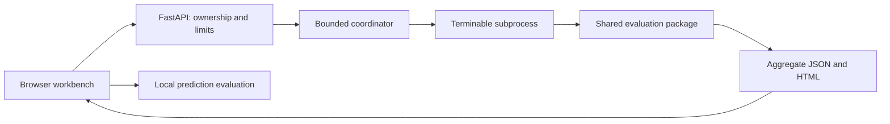

# FixYourDataset: from a research demo to an evaluation workbench

Author: Sherwan Ali.

FixYourDataset helps a visitor answer a concrete question: does a model help on the cases and
decision policy that matter here? It compares named recipes on common held-out rows, distinguishes
ranking from threshold decisions and exports enough settings to inspect or repeat the analysis.

## The problem

The original app demonstrated resampling and ERF-CSRBoost, but its implicit label rules, different
research/application recipes and synchronous work made the results harder to interpret and the
small hosting allocation harder to protect. A strong result from one split also cannot establish
that a method is generally better. The upgrade needed clearer evaluation and resource boundaries.

## What I built

- A reusable Python package and CLI for binary prediction evaluation, mixed-type training,
  train/validation/test splits, review budgets, assumed costs and standalone reports.
- A FastAPI adapter with one web worker, bounded subprocess jobs, bearer capabilities,
  cancellation, expiry and explicit failure states. Numerical work stays outside the event loop.
- A browser workbench with an immediate recorded synthetic example, browser-only prediction
  evaluation, explicit labels/exclusions and held-out model comparisons.
- Integrated resampling exports, a controlled Leakage Lab and new-row scoring. Optional row
  files are separate from aggregate evidence and require explicit permission in the interface.
- A wheel-based production image, locked dependencies, Linux/Windows checks and reproducibility
  bundles. The existing Fly machine and volume are retained.

## Decisions that matter

The positive label is explicit, even when it is the majority class. Identifiers and group/time
columns have named roles. Preprocessing and resampling fit only their training partition; validation
selects a policy and the test partition evaluates it. Failed recipes remain visible rather than
silently falling back to a different method.

There is one maintained evaluation core. The application adapter records its mixed-type recipe
differences; the original research runner and saved research results remain unchanged. A recorded
app example, fictional fixture, fresh upload and historical result have different provenance labels.

The service uses one heavy slot and one waiting slot because it runs on one shared CPU and 1 GB.
A full queue is refused promptly; health requests keep working. Subprocess termination and bounded
temporary storage provide a practical limit on abandoned work. This is not a durable distributed
queue or a per-visitor fairness system.

## A concrete failure and fix

Browser verification found duplicate cost-field ids shared by hidden analysis controls and the
prediction form. Prediction evaluation could read the hidden form's costs. The controls now have
separate ids, with rendered-document uniqueness and browser checks that set deliberately different
costs in the two forms. The result is verified against the visible form's own values.

A second browser check found that the supervisor discarded table-choice details from a worker's
refusal. The archive selector therefore never appeared despite successful conversion tests. The
supervisor now preserves only the bounded, allowlisted selection details, and the HTTP test checks
their exact response. Tests at each layer were needed to catch the missing connection.

## Evidence and limits

Local constrained-image checks exercised exports, private access, queue rejection, cancellation,
compressed-input refusal and repeated jobs. A seeded 10,000-row table with 100 expanded features
completed logistic and ERF fits alongside light conversion; 30 memory samples peaked at 431.5 MiB
inside the one-CPU/1-GB container. This is one fixture and a sampled peak, not a universal capacity
guarantee or a measurement on the production host.

The [verification record](RELEASE-VERIFICATION.md) and
[CI runs](https://github.com/SherwanAli0/erf-csrboost/actions) provide the check scope. Reproduction
checks keep discrete values exact and bound platform-dependent floating-point drift to 1e-12.
Neither the app nor its tests establish real-world business savings, deployment adoption or a
general advantage for ERF. The [research evidence](../research/RESEARCH-EVIDENCE.md) reports its
controls and limitations separately.

## Try it in two minutes

1. Open [FixYourDataset](https://fixyourdataset.fly.dev) and choose **Explore an example**.
2. Inspect the recorded synthetic run, its positive class, split and simple-model comparisons.
3. Download the aggregate HTML/JSON or configuration. No training is needed for this example.
4. Try **Evaluate predictions** with the fictional CSV; this mode does not upload the data.
5. Use **Analyze a dataset** or **Data tools** for a permitted small table. Confirm labels and
   exclusions; request row files only when needed. Treat new-row scoring separately from evaluation.

Owner-led feedback prompts: can a new visitor identify the positive class and test population,
explain one result without help, and find a useful download? No external user trial or outreach
is claimed. See the [API](API.md), [limits](RESOURCE_LIMITS.md) and [local setup](../README.md#3-run-the-app-locally).
